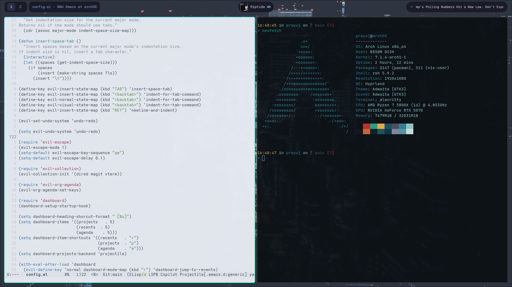

# Screenshots #


# Screencast #
https://github.com/user-attachments/assets/4155bb8f-b879-4eb7-b076-4755835c8ffb

# Desktop configuration #

Hyprland uses `.config/hypr/hyprland.lua` and Quickshell's `panels` IPC for the
launcher, Telegram, notifications, and media shortcuts. Super+Shift+W opens
the dashboard. The SDDM theme and its
public news/market feed collector are in `.config/sddm/neon-dusk/`; the dashboard
reads their cache from `/var/cache/sddm-news/`.

The audio switcher and its user service/timer are included alongside the
Alacritty, native Zsh prompt, wallpaper, and Waybar helper files. Installing or
enabling the SDDM system files is a separate administrative step.

# Private configuration #

Keep credentials in the ignored `.secrets` and `.config/quickshell/.env` files
with permissions `600`. The legacy Waybar news helper reads `NYT_API_KEY` from
the environment; build it with `make -C ~/.config/waybar/scripts/news build`.
The previously committed NYT key must be rotated; it remains in older history.

Telegram requires a local `.config/quickshell/.venv-tg/` with the dependencies
in `.config/quickshell/scripts/telegram-requirements.txt`, plus `API_ID`,
`API_HASH`, and `TG_RAY` in Quickshell's `.env`. Run `telegram-auth` once to
create the ignored Telegram session.

This repository lives at `~/nix`, independently of the rest of the home
directory. Configuration, scripts, tests, and assets live under `files/`.
Screenshots and the recording remain tracked under `.screenshots/`.
The ignore rules exclude credentials, runtime state, dependencies, and build
output. Existing Git history is retained; the new layout is a normal commit.

# Home Manager #

`flake.nix` owns the user environment on Arch Linux. `packages.nix`
contains the development tools and shared Python libraries, `shell.nix`
configures Zsh/Bash, `services.nix` installs the audio-switcher units, and
`files.nix` installs the application configuration from `files/`.
Source files retain their original paths beneath that directory; for example,
edit `files/.config/nvim/init.vim` for Neovim. The live paths in the home
folder are generated by Home Manager and are ignored by Git.
When adding a new source file, run `git add -N <file>` before building so the
Git-backed flake can see it. Existing tracked files need no staging to apply
edits.

The shell uses plain Zsh with built-in completion/history and a small prompt
showing time, directory, Git branch, and Nix-shell status. Aliases live in
`shell.nix`; `c` runs `codex --yolo`, while `codex` itself is the regular
command. `files/zsh/interactive.zsh` contains the native prompt, keybindings,
and personal helpers. A single autosuggestions plugin supplies inline history
and completion suggestions; Tab uses Zsh's built-in completion and Right Arrow
accepts an inline suggestion. Oh My Zsh, Spaceship, and syntax highlighting are
not loaded. `~/.zshrc` is generated and read-only; edit the canonical files and
run `home-manager switch`.

Interactive shells source the private `~/.secrets` at runtime and map the
Bitwarden client variables to the names expected by its CLI. Application
helpers read Quickshell's separate private `.env` at runtime. Home Manager
stores references to those files, not their contents.

The nixpkgs and Home Manager revisions are locked together. The migration
retains the existing August 2025 nixpkgs revision and pins a compatible Home
Manager revision. Updating the lock file is a separate, deliberate operation.

After Nix is installed, bootstrap with:

```sh
nix build ~/nix#homeConfigurations.prayuj.activationPackage
./result/activate
```

Home Manager installs `~/.config/home-manager` as a link to `~/nix`, so normal
commands need no custom profile path or helper aliases:

```sh
home-manager build                      # build without applying
home-manager switch                     # apply the configuration
nix flake update --flake ~/nix           # update the locked dependencies
home-manager generations                 # list previous environments
```

Reactivate an older environment by running its `activate` script from the
store path shown by `home-manager generations`. Generations preserve packages
and generated configuration; they do not back up private state or writable
configuration sources.

Hyprland, Quickshell, Alacritty, and desktop-style source files use writable
links into `files/` so editing, style switching, and palette changes retain
the existing behavior. Their history is kept in Git. The style and palette
writers resolve managed links before atomically replacing a source file.
Other configuration is installed from the Nix store and updated with
`home-manager switch` after editing its canonical source.

Credentials, Telegram sessions, local virtual environments, desktop-style
runtime state, and local wallpaper media remain at their existing private or
runtime paths. Arch/pacman continues to own system packages, the compositor,
GUI applications, and the installed SDDM system configuration. The audio timer
is installed and inactive, with no startup enablement links; its existing
`systemctl --user enable` workflow is available if needed.

The pre-migration configuration, Git index, package inventory, and original
profile details are saved privately under
`~/.local/state/home-manager-migration/2026-11-08/`. The old custom Nix profile
is retained there for recovery; no garbage collection is part of migration.
The directory contains `changes.json` with the source-path mapping and an
executable `rollback.py` that restores the previous live configuration and
profile. It leaves the Home Manager sources and Git state available for review.
The unused local Oh My Zsh clone and Spaceship settings are archived in its
`unused-shell-sources/` directory. The rollback script reinstalls the original
Arch shell plugins if needed when restoring the pre-migration shell.
The removed Arch `go` and `rust` packages can separately be reinstalled with
`sudo pacman -S go rust` if system copies are needed for an AUR build.

# Removed desktop tools #

Ticker, Tickrs, Rofi, SwayNC, and Wob are no longer installed or configured.
Their configuration, startup hooks, obsolete bindings, and Waybar notification
integration have been removed. Quickshell supplies the current launcher,
notifications, and volume display. The old Wob-only audio-event helper and
`volume` alias are removed; the audio server and audio-switcher service remain.
Copies of removed source and the manually installed Ticker binary are kept in
`~/.local/state/home-manager-migration/2026-11-08/app-cleanup/`.
